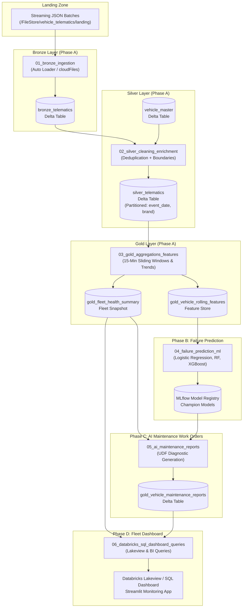

# Databricks Connected Vehicle Streaming, ML & BI Pipeline Notebooks

This directory contains the production-ready Databricks notebooks implementing the complete end-to-end Big Data Analytics (BDA) platform across **Phase A (Data Engineering)**, **Phase B (Machine Learning)**, **Phase C (AI Maintenance Work Orders)**, and **Phase D (Fleet BI Dashboarding)**.

---

## 1. End-to-End Pipeline Execution Flow

---

## 2. Notebook Inventory & Descriptions

### `00_setup_and_data_init.py` (Setup & Master Data)
- **Phase**: Architecture Foundation
- **Purpose**: Creates the `vehicle_telematics_db` catalog database, establishes DBFS storage directories (`landing`, `bronze`, `silver`, `gold`, `checkpoints`), and populates the static `vehicle_master` Delta Lake table with 50 commercial and passenger fleet profiles across 6 major automotive brands (Toyota, Ford, Volvo, Tesla, Freightliner, BMW).
- **Key Widgets**:
  - `base_path`: Storage root (default: `/FileStore/vehicle_telematics`).
  - `database_name`: Target database name (default: `vehicle_telematics_db`).
  - `reset_tables`: Drops existing tables if set to `"true"`.
- **Target Table**: `vehicle_telematics_db.vehicle_master`

### `01_bronze_ingestion.py` (Raw Telematics Ingestion)
- **Phase**: Phase A - Ingestion
- **Purpose**: High-frequency streaming ingestion using **Databricks Auto Loader** (`cloudFiles`) with seamless fallback to standard Structured Streaming.
- **Key Features**:
  - Enforces explicit 34-column `StructType` schema.
  - Appends system audit metadata: `_ingest_timestamp` (`F.current_timestamp()`), `_source_file` (`F.input_file_name()`).
  - Continuous streaming (`processingTime="5 seconds"`) or batch micro-burst (`availableNow=True`).
- **Target Table**: `vehicle_telematics_db.bronze_telematics`

### `02_silver_cleaning_enrichment.py` (Cleansing & Master Join)
- **Phase**: Phase A - Transformation
- **Purpose**: Cleans, deduplicates, bounds, and enriches raw telematics with stationary vehicle metadata.
- **Key Features**:
  - 10-minute watermarking and deduplication on `(vehicle_id, event_timestamp)`.
  - Physical boundary clipping (Speed: 0–200 km/h, RPM: 0–8000, Battery: 5–20V, Brake: 0–20 mm).
  - Stream-Static inner join with `vehicle_master`.
  - Diagnostic event flags (`is_overheating`, `is_low_oil`, `is_high_vibration`, `is_worn_brakes`, `is_battery_critical`, `is_alternator_fault`).
  - Delta Lake table optimization using `OPTIMIZE ... ZORDER BY (vehicle_id, event_timestamp)`.
- **Target Table**: `vehicle_telematics_db.silver_telematics` (Partitioned by `event_date`, `brand`)

### `03_gold_aggregations_features.py` (Feature Engineering & Risk Scoring)
- **Phase**: Phase A - Analytical Aggregations
- **Purpose**: Windowed feature engineering, sensor degradation trends, and composite multi-subsystem risk indices.
- **Key Features**:
  - 15-minute sliding window aggregations (sliding every 5 minutes).
  - Derives min, max, average, and standard deviation across Engine, Brake, and Battery subsystems.
  - Heuristic risk scoring (0–100 scale) for `engine_risk_score`, `brake_risk_score`, `battery_risk_score`.
  - Overall severity categorization (`CRITICAL` >= 60, `WARNING` 30-59, `HEALTHY` < 30).
  - Materializes latest vehicle state snapshot table for low-latency dashboard queries.
- **Target Tables**:
  - `vehicle_telematics_db.gold_vehicle_rolling_features` (ML Feature Store)
  - `vehicle_telematics_db.gold_fleet_health_summary` (Deduplicated Current Fleet Snapshot)

### `04_failure_prediction_ml.py` (Component Failure Prediction & MLflow)
- **Phase**: Phase B - Machine Learning
- **Purpose**: End-to-end supervised learning pipeline predicting component failures across 3 subsystems: Engine (`engine_failure_imminent`), Brakes (`brake_issue_imminent`), and Battery (`battery_issue_imminent`).
- **Key Features**:
  - Anti-leakage rigor: Chronological 80/20 train/test split. Outlier clipping (1st/99th percentiles) and `StandardScaler` fitted strictly on train set.
  - Principal Component Analysis (PCA): Dimensionality reduction retaining ~95% cumulative explained variance.
  - Benchmark comparison: Logistic Regression vs. Random Forest vs. XGBoost on Original Features vs. PCA Components.
  - Class imbalance handling via `class_weight='balanced'` and `scale_pos_weight`.
  - Evaluation prioritizing **Recall** over Precision (100% recall achieved on critical breakdown targets).
  - Full experiment tracking and champion model registration in **MLflow Model Registry**.

### `05_ai_maintenance_reports.py` (AI Maintenance Report Generator)
- **Phase**: Phase C - Natural Language Work Orders
- **Purpose**: Generates structured, natural-language maintenance diagnostic work orders based on model predictions and telemetric anomalies.
- **Key Output Columns**:
  1. `failure_probability`: Continuous likelihood of component breakdown (0.0 to 1.0).
  2. `predicted_failure_type`: Root cause diagnosis (`Engine_Overheat`, `Low_Oil_Pressure`, `Brake_Pad_Worn`, `ABS_Malfunction`, `Battery_Degraded`, `Alternator_Failure`, `Healthy`).
  3. `maintenance_report`: Comprehensive human-readable garage work order detailing recommended mechanic actions, required replacement parts, and estimated service downtime hours.
- **Target Table**: `vehicle_telematics_db.gold_vehicle_maintenance_reports`

### `06_databricks_sql_dashboard_queries.py` (Lakeview & BI Queries)
- **Phase**: Phase D - BI & Fleet Dashboard
- **Purpose**: Complete collection of optimized SQL queries ready for building interactive **Databricks SQL Dashboards** or **Lakeview Dashboards**.
- **Visualizations / Queries Provided**:
  1. **Widget 1: Fleet Health KPI Summary** (Total fleet size, healthy count, warning count, critical count, average speed, average fleet risk index).
  2. **Widget 2: Fleet Risk Distribution** (Donut / Pie chart breakdown by `fleet_health_status`).
  3. **Widget 3: High-Risk Priority Queue** (Ranked vehicle table filtered by `failure_probability >= 0.30`).
  4. **Widget 4: Subsystem Health by Brand** (Grouped bar chart for engine, brake, and battery risk scores).
  5. **Widget 5: Interactive GPS Fleet Map** (Point map with coordinates colored by health status).
  6. **Widget 6: AI Diagnostic Work Order Inspector** (Detailed view of the generated `maintenance_report` for critical vehicles).

---

## 3. How to Import and Run in Databricks Free / Community Edition

### Step 1: Import Notebooks into Databricks
1. In the Databricks web UI, navigate to **Workspace** > **Users** > `your_username`.
2. Click the dropdown arrow next to your user folder and select **Import**.
3. Import all 7 notebooks from `notebooks/`:
   - `00_setup_and_data_init.py`
   - `01_bronze_ingestion.py`
   - `02_silver_cleaning_enrichment.py`
   - `03_gold_aggregations_features.py`
   - `04_failure_prediction_ml.py`
   - `05_ai_maintenance_reports.py`
   - `06_databricks_sql_dashboard_queries.py`

### Step 2: Upload Data to DBFS / Volumes
1. Navigate to **Catalog** > **DBFS** (or Unity Catalog Volumes).
2. Create directory: `/FileStore/vehicle_telematics/landing/`.
3. Upload the streaming JSON batch files from `data/landing/`.
4. Upload `data/historical_labeled_telematics.parquet` to `/FileStore/vehicle_telematics/`.

### Step 3: Execute Notebooks in Sequence
Attach your cluster (Databricks Runtime 13.x+ or 14.x LTS with ML or Standard) and execute:
1. **`00_setup_and_data_init`**: Initializes database and creates `vehicle_master`.
2. **`01_bronze_ingestion`**: Streams landing files into `bronze_telematics`.
3. **`02_silver_cleaning_enrichment`**: Cleans, deduplicates, and joins into `silver_telematics`.
4. **`03_gold_aggregations_features`**: Computes rolling windows and risk indices into `gold_vehicle_rolling_features` and `gold_fleet_health_summary`.
5. **`04_failure_prediction_ml`**: Trains benchmark models, compares PCA, and logs to MLflow.
6. **`05_ai_maintenance_reports`**: Generates AI diagnostic reports into `gold_vehicle_maintenance_reports`.
7. **`06_databricks_sql_dashboard_queries`**: Run SQL queries or copy into Databricks SQL / Lakeview to visualize the fleet.
